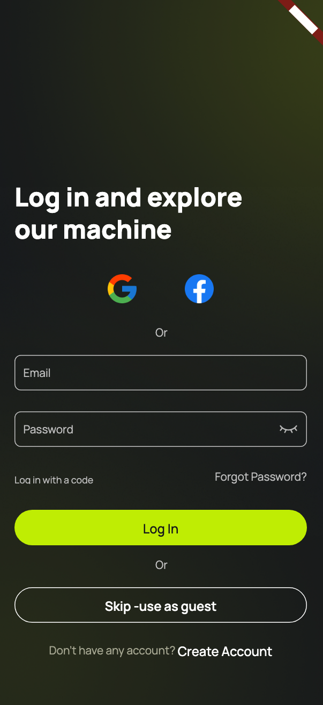
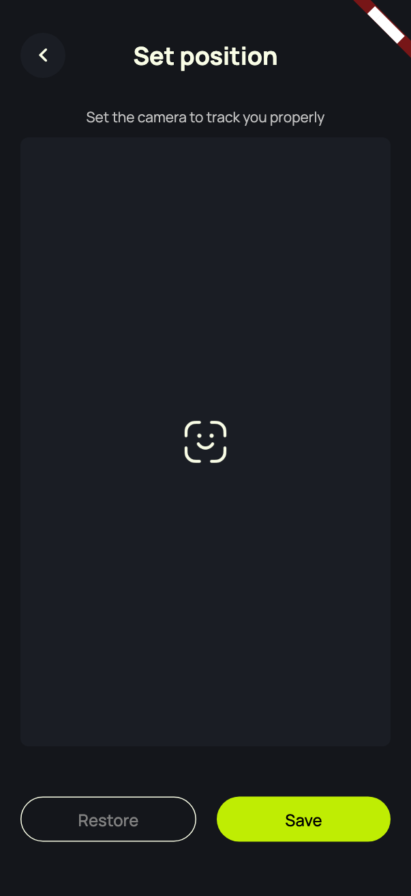
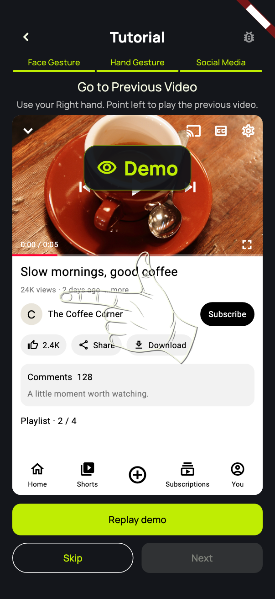

# Gesture Control Demo

A Flutter portfolio project by **Sony Khan**: learn hand gestures, practice
YouTube-style actions, and personalize an animated face that follows your movement.

**This is a standalone offline demo.** Account screens use local sample data;
hand and face recognition use the real phone camera and bundled MediaPipe models.
A visible DEMO ribbon distinguishes this build.

[Validation](docs/VALIDATION.md) · [Complete UI gallery](docs/UI_GALLERY.md) · [Demo authentication](docs/AUTHENTICATION.md) · [App flow](docs/FLOW.md)

## Try it

| Item | Demo value |
|---|---|
| Email | `demo@example.com` |
| Password | `Demo1234!` |
| Verification/reset code | `12345678` |

Login is prefilled. You can also use Guest, register a fictional email, try login
with a code, or reset a local account password. No email is sent. Google/Facebook
icons simulate sign-in locally and never open those providers. Use fictional
credentials only; this local adapter is not a secure authentication service.
Local accounts and preferences remain on the device until its demo app data is
cleared. App sessions use the platform secure store with this demo's own app ID.

To reach camera practice without hardware: **Guest or Log In → Add Device →
Manually → Gesture Control → Connect → Set Position → Choose hand**.
Allow camera permission for recognition. Auto Search demonstrates real foreground
Bluetooth discovery, but stand connection and commands are simulated.

## Screens

<table>
<tr><th>Login</th><th>Camera setup</th><th>YouTube practice</th></tr>
<tr>
<td></td>
<td></td>
<td></td>
</tr>
</table>

The gallery covers **61 screen states / 122 portrait and landscape renders**.
It uses the actual widgets with sample service adapters and blank camera regions;
provider pages and native permission sheets are outside the gallery.

## What is real, and what is simulated?

| Feature | Implementation |
|---|---|
| Hand recognition | Real camera frames, 21 landmarks, physical Left/Right enforcement, temporal pose/movement matching |
| Face following | Real face position, mouth expressions, proportional movement, saved resting point, both face styles |
| Camera lifecycle | Real permission recovery, front-camera preview, background/resume and orientation handling |
| Training | 13 Hand lessons, 8 YouTube-style actions and 5 Face exercises, feedback and automatic advancement |
| Appearance | Persisted colors, expressions, modes, hand choice and camera point |
| Languages | English, Chinese, Japanese, Thai, Vietnamese, Indonesian, Malay, Filipino, Portuguese |
| Email/social auth | Local demonstration; no backend requests, emails or provider authentication |
| Stand setup | Manual setup simulation; real BLE discovery is optional |
| YouTube practice | Local media simulation; does not control the installed YouTube app |

## Run

Flutter **3.41.7** is pinned in `.fvmrc`; Android requires JDK **17**, SDK **36**
and NDK **28.2.13676358**. iOS requires Xcode/CocoaPods and a development team
for installation on a real iPhone. Recognition requires Android/iOS camera hardware.

```sh
fvm flutter pub get
fvm flutter run
fvm flutter analyze --no-pub
fvm flutter test --no-pub
fvm flutter build apk --debug --no-pub
fvm flutter build ios --debug --no-codesign --no-pub
```

Android APK: `build/app/outputs/flutter-apk/app-debug.apk`.
The debug APK is for testing, not store distribution. iOS minimum deployment
target is 13.0; unsigned builds require signing before phone installation.

| Platform | Separate demo application ID |
|---|---|
| Android | `com.sonykhan.gesture_demo` |
| iOS | `com.sonykhan.gestureDemo` |

## Architecture

- `lib/app/`: navigation, saved settings, themes and localization wiring.
- `lib/features/auth/services/demo_auth.dart`: local account/code/session adapter.
- `lib/features/hand_tracking/` and `face_tracking/`: validated observations and rendering.
- `lib/shared/camera/`: one camera owner, lifecycle management and platform frame schema.
- `android/` and `ios/`: native MediaPipe inference adapters; `models/` supplies shared models.
- `lib/features/tutorials/`: gesture acquisition, selected-hand checks, progress and lesson actions.
- `test/`: auth, geometry, lifecycle, responsive UI and recognition-contract checks.
- `tools/ui_gallery.dart`: reproducible sample-data screenshots.

The default auth transport rejects network calls. `main.dart` injects
`DemoAuthApi` and `DemoSocialBrowser`; neither uses a server or system browser.
The retained auth service demonstrates validation, navigation and session lifecycle
against this local adapter. Recognition frames stay in memory and are not uploaded.

## Scope and attribution

This repository is an independent snapshot with fresh Git history and separate
application IDs. Production credentials, deployment URLs, internal validation
records and historical recordings are excluded. It is maintained separately.

MediaPipe models and sample media retain their original notices:
[model attribution](models/README.md), [MediaPipe license](models/MediaPipe-LICENSE.txt),
[sample media](assets/social_practice/README.md), and
[test-image sources](test/fixtures/images/README.md).
Google, Facebook and YouTube names/icons identify simulated teaching interfaces;
this project is not affiliated with those platforms. This snapshot does not grant
an additional redistribution license for app artwork or branding.
